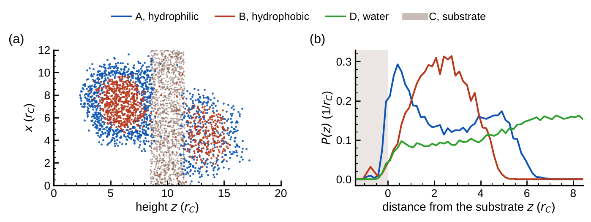

# Dissipative particle dynamics from scratch

Four notebooks teach dissipative particle dynamics (DPD), from the three pair forces to a self-assembling block
copolymer coating. Notebook 01 writes a DPD code in NumPy and checks it against the standard DPD fluid of Groot and
Warren; notebook 02 measures the Flory–Huggins χ of DPD mixtures against the repulsion a<sub>ij</sub>; notebook 03
runs melts of diblock copolymers in LAMMPS and compares their structures with the mean-field phase diagram, after
Groot and Madden; notebook 04 builds a small version of the DPD coating models of diblock copolymers on a
cellulose-like substrate in water. The material follows the papers of Hoogerbrugge and Koelman, Español and Warren,
Groot and Warren, and Groot and Madden, and the methods chapter of the doctoral thesis *Computational modelling of
block copolymer surface coatings at multiple length scales* (2026).

[](https://colab.research.google.com/github/Kourosh-h/dpd-teaching/blob/main/notebooks/01_dpd_fluid.ipynb)



## What the code computes

| Quantity | Reference | Data |
|--|--|--|
| Temperature against the time step, equation of state, g(r) and diffusion of the DPD fluid | Groot and Warren (1997), Figs. 1, 2 and 4 and Eq. 16 | NumPy; 1372 to 1536 beads, ρ from 1 to 8, a = 15, 25 and 30 |
| Flory–Huggins χ against Δa = a<sub>AB</sub> − a<sub>AA</sub>, for single beads and chains of 2 to 8 beads | Groot and Warren (1997), Eqs. 24 and 27 | NumPy; two-phase slabs of 3840 beads in 8 × 8 × 20 r<sub>C</sub>³ |
| Chain size and mesophases of A<sub>n</sub>B<sub>10−n</sub> melts at χN = 46 | Groot and Madden (1998), Eq. 10, Tables I and II | LAMMPS; 5180 beads in 12³ r<sub>C</sub>³, 1000 τ per run |
| Density profiles of A<sub>4</sub>B<sub>3</sub>, A<sub>6</sub>B<sub>1</sub> and A<sub>3</sub>B<sub>4</sub> + B<sub>19</sub> coatings, water at the hydrophobic layer | the coating models of the thesis | LAMMPS; 8640 beads in 12 × 12 × 20 r<sub>C</sub>³, 1000 τ per run |

Each notebook starts with the background and basic definitions it needs and ends with exercises and their solutions.
The melts and coatings are much smaller and shorter than the published simulations, so they show qualitative trends,
not converged numbers.

## Result

The NumPy code holds k<sub>B</sub>T at 1.026 with Δt = 0.04 τ (Groot and Warren: 2 % above 1) and reproduces the
equation of state of Groot and Warren, with (p − ρk<sub>B</sub>T)/(aρ²) rising to 0.101 at ρ = 8. The measured χ of
single beads grows as χ = 0.296 Δa (0.286 Δa in the paper), and χ/Δa stays between 0.295 and 0.312 for chains of 2 to
8 beads. In LAMMPS, the 10-bead chains have √⟨R²⟩ = 3.01 r<sub>C</sub>, as in Groot and Madden, and at χN = 46
A<sub>5</sub>B<sub>5</sub> forms lamellae, A<sub>3</sub>B<sub>7</sub> cylinders and A<sub>2</sub>B<sub>8</sub>
micelles within 1000 τ. In the coating model, A<sub>4</sub>B<sub>3</sub> forms adsorbed aggregates with an A–B–A
order on the substrate, and an added B<sub>19</sub> homopolymer forms the middle layer of an A–B<sub>19</sub>–A film.

## Files

- `notebooks/01_dpd_fluid.ipynb`: the DPD forces, the Groot–Warren integrator and the standard DPD fluid
- `notebooks/02_chi_to_aij.ipynb`: Flory–Huggins theory, χ from two-phase simulations, spinodal decomposition and the
  coating parameters
- `notebooks/03_diblock_mesophases.ipynb`: diblock copolymer melts in LAMMPS against the mean-field phase diagram
- `notebooks/04_copolymer_coating.ipynb`: diblock copolymers coating a cellulose-like substrate in water, in LAMMPS
- `notebooks/figures/`: every plot of the notebooks as a PDF file, written when the notebooks run
- `requirements.txt`: the Python packages

The notebooks need no other files; notebooks 03 and 04 write their LAMMPS data files to `notebooks/work/`.

## Running the notebooks

Open a notebook in Jupyter, VS Code or Colab and run all cells. The first cell checks for the packages (NumPy, SciPy,
Matplotlib, pandas, ASE and py3Dmol, and for notebooks 03 and 04 the pip versions of LAMMPS and MPICH) and installs
those that are missing; restart the kernel if a later import fails after an install. The next cell of notebooks 03
and 04 loads the MPI library that the pip version of LAMMPS needs on Linux and Colab. The 3D viewers show only while
the notebook runs. On Colab:

- notebook 01, about 4 min: [](https://colab.research.google.com/github/Kourosh-h/dpd-teaching/blob/main/notebooks/01_dpd_fluid.ipynb)
- notebook 02, about 10 min: [](https://colab.research.google.com/github/Kourosh-h/dpd-teaching/blob/main/notebooks/02_chi_to_aij.ipynb)
- notebook 03, about 20 min: [](https://colab.research.google.com/github/Kourosh-h/dpd-teaching/blob/main/notebooks/03_diblock_mesophases.ipynb)
- notebook 04, about 20 min: [](https://colab.research.google.com/github/Kourosh-h/dpd-teaching/blob/main/notebooks/04_copolymer_coating.ipynb)

Elsewhere, the packages can also be installed first:

```
pip install -r requirements.txt
jupyter lab notebooks/
```

## References

- DPD: P. J. Hoogerbrugge and J. M. V. A. Koelman, *Europhys. Lett.* **19**, 155–160 (1992).
- DPD thermostat: P. Español and P. Warren, *Europhys. Lett.* **30**, 191–196 (1995).
- DPD parameters: R. D. Groot and P. B. Warren, *J. Chem. Phys.* **107**, 4423–4435 (1997),
  https://doi.org/10.1063/1.474784.
- Block copolymer mesophases in DPD: R. D. Groot and T. J. Madden, *J. Chem. Phys.* **108**, 8713–8724 (1998),
  https://doi.org/10.1063/1.476300.
- LAMMPS: A. P. Thompson et al., *Comput. Phys. Commun.* **271**, 108171 (2022).
- Thesis: K. Hasheminejad, *Computational modelling of block copolymer surface coatings at multiple length scales*,
  doctoral thesis (2026), http://urn.fi/URN:ISBN:978-952-64-2955-7.
- Coating, block length ratio: A. Scacchi, K. Hasheminejad, S. Javan Nikkhah and M. Sammalkorpi, *J. Colloid
  Interface Sci.* **640**, 809–819 (2023).
- Coating with a hydrophobic polymer: K. Hasheminejad et al., *Appl. Surf. Sci.* **640**, 158324 (2023).

The notebooks have the full list.

## Author

Kourosh Hasheminejad
